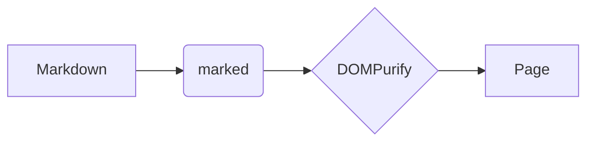
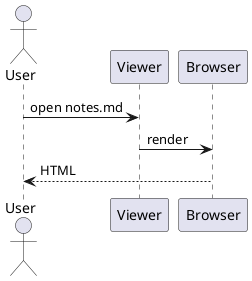

# mdview sample

Intro with **bold**, *italic*, ~~strike~~, `code`, a link to [other doc](sub/other.md#second), an autolink https://example.com and a footnote.[^1]

## Table & tasks

| Lib | Size | Note |
|:----|-----:|:----:|
| marked | 40 KB | parser |
| mermaid | 2.6 MB | lazy |

- [x] done
- [ ] todo

## Code

```js
const greet = (name) => `Hello, ${name}!`;
console.log(greet('world'));
```

```python
def f(x: int) -> int:
    return x * 2
```

## Math

Inline $E = mc^2$ and prices $5 and $10 stay text.

$$
\int_0^\infty e^{-x^2}\,dx = \frac{\sqrt{\pi}}{2}
$$

## Diagram



## PlantUML



```puml
class Viewer {
  +render(text)
}
class Loader
Viewer --> Loader : reads
Loader <|-- FileLoader
```

## Alerts

> [!NOTE]
> Useful information.

> [!WARNING]
> Careful here.

## Images

Images are loaded relative to the Markdown file — here from a subfolder, with spaces in the names.

Vector (SVG), Markdown syntax with a hover title:


Raster (PNG), an HTML `` tag with a width — a Mandelbrot set, seahorse valley:


<details><summary>HTML details</summary>Hidden text <script>alert('xss')</script></details>

[^1]: The footnote text.
